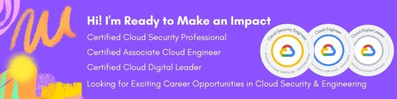

<div align="center">


# Hi there, I'm Gouthami 👋
### 🛡️ Google Cloud Certified Security Engineer | Cloud Infrastructure & VAPT

[](https://www.linkedin.com/in/gouthami-gcp/)
[](https://www.credly.com/users/gouthami-gcp)

---

</div>

## 📌 About Me

- 🔐 Certified **Google Cloud Professional Security Engineer** passionate about building resilient, zero-trust cloud architectures.
- 🎯 Specializing in **IAM, Cloud Security Posture Management, VPC Service Controls, Data Protection, and VAPT**.
- 💼 **LinkedIn Profile:** [linkedin.com/in/gouthami-gcp](https://www.linkedin.com/in/gouthami-gcp/)

---

## 🏆 Verified Certifications & Badges

<table align="center" width="100%">
  <thead>
    <tr align="center">
      <th width="15%">Badge</th>
      <th width="35%">Certification</th>
      <th width="20%">Status & Validity</th>
      <th width="20%">Key Domains & Skills</th>
      <th width="10%">Verification</th>
    </tr>
  </thead>
  <tbody>
    <tr>
      <td align="center" valign="middle">
        <a href="https://www.credly.com/badges/6ce3d22a-55e5-4209-a656-2d5a7d30328a" target="_blank">
          
        </a>
      </td>
      <td valign="middle">
        <b>Professional Cloud Security Engineer</b><br>
        <sub>Google Cloud</sub>
      </td>
      <td valign="middle">
        <br>
        📅 <b>Issued:</b> Mar 2025<br>
        ⌛ <b>Expires:</b> Mar 2027
      </td>
      <td valign="middle">
        <code>Cloud Security</code> <code>IAM</code><br>
        <code>VPC Security</code> <code>Python</code>
      </td>
      <td align="center" valign="middle">
        <a href="https://www.credly.com/badges/6ce3d22a-55e5-4209-a656-2d5a7d30328a" target="_blank">
          
        </a>
      </td>
    </tr>
    <tr>
      <td align="center" valign="middle">
        <a href="https://www.credly.com/badges/24271424-18c5-4a3f-a0ac-67dd7ffcc120" target="_blank">
          
        </a>
      </td>
      <td valign="middle">
        <b>Associate Cloud Engineer</b><br>
        <sub>Google Cloud</sub>
      </td>
      <td valign="middle">
        <br>
        📅 <b>Issued:</b> Jan 2025<br>
        ⌛ <b>Expires:</b> Jan 2028
      </td>
      <td valign="middle">
        <code>VAPT</code> <code>Cloud Infra</code><br>
        <code>GCP Services</code> <code>Python</code>
      </td>
      <td align="center" valign="middle">
        <a href="https://www.credly.com/badges/24271424-18c5-4a3f-a0ac-67dd7ffcc120" target="_blank">
          
        </a>
      </td>
    </tr>
    <tr>
      <td align="center" valign="middle">
        <a href="https://www.credly.com/badges/aca95c45-ce24-44e8-8d10-157bd3300e9d" target="_blank">
          
        </a>
      </td>
      <td valign="middle">
        <b>Cloud Digital Leader</b><br>
        <sub>Google Cloud</sub>
      </td>
      <td valign="middle">
        <br>
        📅 <b>Issued:</b> Dec 2024<br>
        ⌛ <b>Expires:</b> Dec 2027
      </td>
      <td valign="middle">
        <code>GCP Fundamentals</code><br>
        <code>Cloud Architecture</code>
      </td>
      <td align="center" valign="middle">
        <a href="https://www.credly.com/badges/aca95c45-ce24-44e8-8d10-157bd3300e9d" target="_blank">
          
        </a>
      </td>
    </tr>
    <tr>
      <td align="center" valign="middle">
        <a href="https://www.cloudskillsboost.google/public_profiles/f5b3d251-bd7b-4820-8c3c-5ab1b1c9b755/badges/12370362" target="_blank">
          
        </a>
      </td>
      <td valign="middle">
        <b>Certified Cloud Security Professional (CCSP)</b><br>
        <sub>Google Cloud Skills Boost</sub>
      </td>
      <td valign="middle">
        <br>
        📅 <b>Issued:</b> Oct 2024<br>
        🆔 <code>12370362</code>
      </td>
      <td valign="middle">
        <code>Cloud Security</code><br>
        <code>Threat Mitigation</code>
      </td>
      <td align="center" valign="middle">
        <a href="https://www.cloudskillsboost.google/public_profiles/f5b3d251-bd7b-4820-8c3c-5ab1b1c9b755/badges/12370362" target="_blank">
          
        </a>
      </td>
    </tr>
    <tr>
      <td align="center" valign="middle">
        <a href="https://www.coursera.org/account/accomplishments/specialization/certificate/VHGM1GXASNEU" target="_blank">
          
        </a>
      </td>
      <td valign="middle">
        <b>Google Cybersecurity Professional Certificate</b><br>
        <sub>Google / Coursera</sub>
      </td>
      <td valign="middle">
        <br>
        📅 <b>Completed</b><br>
        🆔 <code>VHGM1GXASNEU</code>
      </td>
      <td valign="middle">
        <code>SIEM Tools</code> <code>Threat Analysis</code><br>
        <code>Incident Response</code> <code>Python</code>
      </td>
      <td align="center" valign="middle">
        <a href="https://www.coursera.org/account/accomplishments/specialization/certificate/VHGM1GXASNEU" target="_blank">
          
        </a>
      </td>
    </tr>
  </tbody>
</table>

---

## 🛠️ Core Competencies & Tech Stack

```text
☁️ Cloud Platforms   : Google Cloud Platform (GCP)
🛡️ Cloud Security    : IAM, VPC Service Controls, Cloud KMS, Security Command Center (SCC)
🔍 Penetration Test  : Vulnerability Assessment and Penetration Testing (VAPT)
💻 Scripting & Devops: Python, Bash, Git, CI/CD
```

---

<div align="center">


  <sub>Let's connect: <a href="https://www.linkedin.com/in/gouthami-gcp/">linkedin.com/in/gouthami-gcp</a></sub>
</div>
